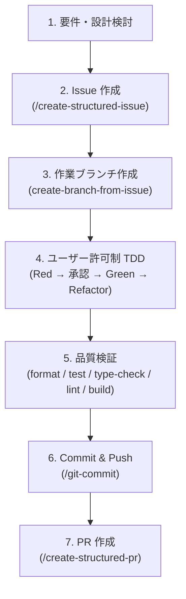

# AI エージェント開発基盤ガイド（`.agents/`）

本ドキュメントは、`toybox2` リポジトリにおける開発規約・標準ワークフロー・自動化スキル（`.agents/` 配下の資産）をまとめた開発者向けリファレンスです。リポジトリ全体の概要・アプリ一覧・npm コマンドについては [ルート `README.md`](../README.md) を参照してください。

---

## 概要と 3 層構造

`.agents/` 配下は、責務ごとに以下の 3 層で構成されています。

| ディレクトリ | 役割 | 特徴 |
| :--- | :--- | :--- |
| [`.agents/rules/`](rules/) | **開発規約・品質予防ルール** | 設計方針、コーディング標準、TDD 規約、ブランチ命名規則、定量的品質ゲートを定義 |
| [`.agents/workflows/`](workflows/) | **承認ゲート付き標準作業手順** | スラッシュコマンド（`/<name>`）として呼び出すオーケストレーション手順書。各工程の境界でユーザー確認を必須化 |
| [`.agents/skills/`](skills/) | **再利用可能な調査・検証・実行ツール** | ワークフローから呼び出されるアトミックな知識・PowerShell / Node スクリプト群（JSON 入出力・副作用分離） |

---

## 開発ルール一覧（`.agents/rules/`）

| ファイル名 | タイトル | 主な適用スコープ・内容 |
| :--- | :--- | :--- |
| [`code-style-common.md`](rules/code-style-common.md) | モノレポ共通開発・品質予防規約（Common Rules & Implementation Prevention） | リポジトリ全体（`apps/*`, `packages/*`）対象。関数行数（50 行以内）・認知的複雑度（15 以下）・`any` 禁止・純粋関数分離・SCSS トークン/Mixin 規約・Git ブランチ戦略・拡張機能 ZIP 同梱規約・定量的品質ゲート |
| [`code-style-stepnote.md`](rules/code-style-stepnote.md) | プロジェクト固有開発ルール（Project Rules: Step-Note） | `apps/stepnote/` 対象。5 ペイン＋一覧モード画面構成、`LayoutUIController`、Pure Lit + Dexie 層分離、ユーザー許可制 TDD、簡易 BEM / テーマ遷移規約、標準作業ワークフロー |

---

## ワークフロー一覧（`.agents/workflows/`）

| コマンド | ファイル | 概要 |
| :--- | :--- | :--- |
| `/create-structured-issue` | [`create-structured-issue.md`](workflows/create-structured-issue.md) | リポジトリコンテキストを調査し、新フォーマット規約（チェックリスト禁止・得られる効果明記等）に沿った GitHub Issue を承認ゲート付きで作成 |
| `/create-structured-pr` | [`create-structured-pr.md`](workflows/create-structured-pr.md) | ブランチ差分・コミット履歴・関連 Issue を収集し、Why 重視・検証結果明記の Pull Request を承認ゲート付きで作成 |
| `/git-commit` | [`git-commit.md`](workflows/git-commit.md) | ステージング済み差分のみから、変更理由・設計判断（Why）を重視した日本語コミットメッセージを生成し、承認後にコミットを実行 |
| `/refactor-executor` | [`refactor-executor.md`](workflows/refactor-executor.md) | 段階的実行計画書に基づき、4 大観点合意・Issue・TDD・品質ゲート実測・台帳記録の 8 ステップで TypeScript リファクタリングを反復実行 |
| `/release-app` | [`release-app.md`](workflows/release-app.md) | 各アプリごとの状態調査・バージョン更新 PR 作成・`main` マージ後の GitHub Release 公開（成果物付き）・GitHub Wiki ダウンロードポータル自動同期を承認ゲート付きで実行 |
| `/scss-refactor-executor` | [`scss-refactor-executor.md`](workflows/scss-refactor-executor.md) | SCSS の重複解消・アンチパターン排除・簡易 BEM 標準化を、3 層判定基準と品質ゲート実測により画面崩壊なく段階的に反復実行 |
| `/update-readme` | [`update-readme.md`](workflows/update-readme.md) | `readme-inventory` スキルでリポジトリ実態と差分を自動収集し、承認を経てルート `README.md` と `.agents/README.md` を一括定期更新 |

---

## スキル一覧（`.agents/skills/`）

| スキル名 | 定義ファイル | 概要 | 付属スクリプト |
| :--- | :--- | :--- | :--- |
| `create-branch-from-issue` | [`SKILL.md`](skills/create-branch-from-issue/SKILL.md) | GitHub Issue 情報（番号・タイトル・ラベル）から規約に沿った作業ブランチを生成・チェックアウト | なし（手順定義のみ） |
| `issue-create` | [`SKILL.md`](skills/issue-create/SKILL.md) | 一時ファイル経由でタイトル・複数行本文を安全に受け渡し、規約準拠の GitHub Issue を登録 | [`create-issue.ps1`](skills/issue-create/scripts/create-issue.ps1) |
| `pr-create` | [`SKILL.md`](skills/pr-create/SKILL.md) | 事前検証およびリモート push（`-AutoPush`）を含め、`gh pr create` を安全に実行 | [`create-pr.ps1`](skills/pr-create/scripts/create-pr.ps1) |
| `readme-inventory` | [`SKILL.md`](skills/readme-inventory/SKILL.md) | ワークスペース・npm スクリプト・依存・CI・`.agents/` 資産と既存ドキュメントとのズレ（`driftHints`）を JSON で一括収集（読み取り専用） | [`inspect-readme-inventory.ps1`](skills/readme-inventory/scripts/inspect-readme-inventory.ps1) |
| `refactor-audit` | [`SKILL.md`](skills/refactor-audit/SKILL.md) | ESLint / jscpd / madge による静的解析と文脈調査でリファクタリング台帳（`.agents/refactor-backlog.json`）を生成・更新 | [`run-audit.ps1`](skills/refactor-audit/scripts/run-audit.ps1), [`aggregate-reports.mjs`](skills/refactor-audit/scripts/aggregate-reports.mjs) |
| `refactor-verify` | [`SKILL.md`](skills/refactor-verify/SKILL.md) | 台帳への副作用なく、単体テスト・型チェック・コード重複・単一 HTML ビルドを一括実測・検証 | [`verify-refactor.ps1`](skills/refactor-verify/scripts/verify-refactor.ps1) |
| `release-manager` | [`SKILL.md`](skills/release-manager/SKILL.md) | 各アプリごとの独立バージョン管理、CHANGELOG 更新、GitHub Releases 公開（成果物添付）、および GitHub Wiki ダウンロードポータル自動同期を実行 | [`inspect-release-state.ps1`](skills/release-manager/scripts/inspect-release-state.ps1), [`bump-version.ps1`](skills/release-manager/scripts/bump-version.ps1), [`publish-release.ps1`](skills/release-manager/scripts/publish-release.ps1), [`sync-wiki.ps1`](skills/release-manager/scripts/sync-wiki.ps1) |
| `repo-context-inspect` | [`SKILL.md`](skills/repo-context-inspect/SKILL.md) | Issue / PR 作成に必要なブランチ・ラベル・類似 Issue・コミット履歴・差分統計を JSON で一括収集（読み取り専用） | [`inspect-context.ps1`](skills/repo-context-inspect/scripts/inspect-context.ps1) |
| `scss-refactor-tools` | [`SKILL.md`](skills/scss-refactor-tools/SKILL.md) | SCSS コードベースの重複・アンチパターン監査およびリファクタリング後品質ゲートの一括実測・台帳更新 | [`audit-scss.ps1`](skills/scss-refactor-tools/scripts/audit-scss.ps1), [`verify-scss.ps1`](skills/scss-refactor-tools/scripts/verify-scss.ps1) |

---

## 標準的な開発・定期更新サイクル

### 通常の機能開発・不具合修正

### ドキュメントの定期更新（`/update-readme`）

ワークスペース追加、npm スクリプト変更、`.agents/` 配下のルール・ワークフロー・スキル追加時、または定期棚卸しのタイミングで `/update-readme` を実行します。

1. `inspect-readme-inventory.ps1` を実行し、リポジトリ実態と `driftHints`（記載漏れ・リンク漏れ）を取得する。
2. 差分サマリーと更新案プレビューを確認し、ユーザー承認を得る。
3. ルート `README.md` と `.agents/README.md` を一括更新する。
4. `inspect-readme-inventory.ps1` の再実行で `driftHints` が空であることを確認し、`npm run format -- README.md` でフォーマットを整える。

### アプリのリリース・Wiki 配布（`/release-app`）

各アプリ（`stepnote`, `stepnote-migrator`, `ext-hubaddress` 等）のバージョンを上げて配布する際は `/release-app` を実行します。

1. **Phase A（リリース準備 PR）**: `inspect-release-state.ps1` で変更履歴を調査 → 承認後に `bump-version.ps1` で `package.json`（拡張機能は `manifest.json` も）・`package-lock.json`・`CHANGELOG.md` を同期更新し、PR を作成して `main` へマージする。
2. **Phase B（公開 ＆ Wiki 反映）**: `main` 最新同期後、承認を経て `publish-release.ps1` で独立タグ（`<scope>@v<version>`）と配布ファイル付き GitHub Release を公開し、`sync-wiki.ps1` で GitHub Wiki のダウンロードポータルを自動更新する。
