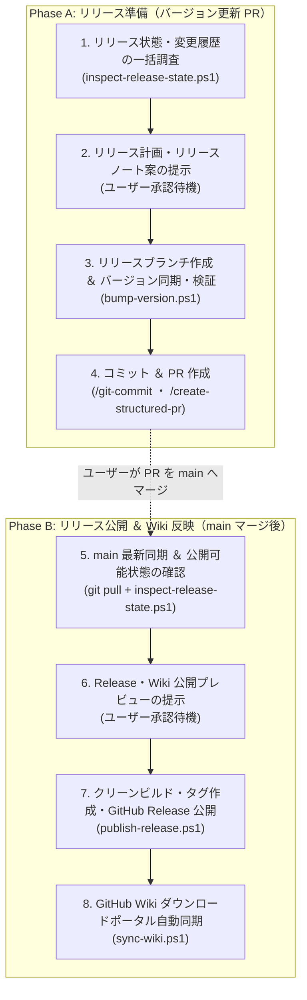

# Release App Workflow (`/release-app`)

## 目的

モノレポ配下の各アプリケーション（`apps/stepnote`, `apps/stepnote-migrator`, `apps/extension-hubaddress` 等）を独立したバージョンライフサイクルで管理し、以下を一貫して安全に実行するための標準ワークフローです。

1. **Phase A（リリース準備 PR）**: 変更履歴の収集、セマンティックバージョン決定、`package.json`（拡張機能は `public/manifest.json` も）・`package-lock.json`・`CHANGELOG.md`・ルート `README.md`（該当アプリバージョン表記がある場合）の同期更新、品質検証、および `main` 向け PR の作成。
2. **Phase B（リリース公開 ＆ Wiki 反映）**: バージョン更新 PR が `main` へマージされた後、独立タグ（`<scope>@v<version>`）作成、配布成果物（単一 HTML / 拡張機能 ZIP）を添付した GitHub Release 公開、および GitHub Wiki ダウンロードポータルの自動更新。

---

## CRITICAL CONSTRAINTS（厳格制約）

1. **調査スキル（`inspect-release-state.ps1`）の必須実行**:
   - エージェントの記憶や推測だけでバージョン番号や変更内容を決定してはならない。必ず最初に `inspect-release-state.ps1` を実行し、実測 JSON に基づいて計画を提示すること。
2. **各フェーズ境界での絶対確認（承認ゲート）**:
   - 以下の境界では必ずプレビューを提示してユーザー承認を待機し、明示的な許可（「OK」「進めてください」等）なしに次工程へ進んではならない：
     - リリース計画提示 → バージョン更新（`bump-version.ps1`）実行
     - 更新・検証完了 → コミット（`/git-commit`）＆ PR 作成（`/create-structured-pr`）
     - `main` マージ後の公開プレビュー提示 → Release 公開（`publish-release.ps1`）＆ Wiki 同期（`sync-wiki.ps1`）
3. **`main` マージ前リリースの禁止**:
   - タグ作成および GitHub Release 公開は、必ずバージョン更新 PR が `main` へマージされ、`origin/main` と最新同期されたクリーンな `main` ブランチ上で行うこと。
4. **拡張機能 ZIP 同梱規約の遵守**:
   - ブラウザ拡張機能（`ext-hubaddress` 等）のバージョン更新時は、`bump-version.ps1` のビルドステップ（`npm run package:ext-hubaddress`）により `dist/` および `dist-zip/hubaddress-extension.zip` もバージョン反映済みバイナリへ同時更新し、同一 PR へ含めること。

---

## ワークフロー全体像（2 フェーズ・8 ステップ）



---

## Phase A: リリース準備（バージョン更新 PR 作成）

### Step 1: リリース状態と未リリース変更履歴の収集

1. 調査スクリプトを実行し、対象アプリ（または全アプリ）の現在状態を取得する：

```powershell
pwsh -File .agents/skills/release-manager/scripts/inspect-release-state.ps1 -Pretty
```

2. 取得 JSON から以下を確認する：
   - `errorMessage` がある場合は原因を報告して中断する。
   - `unregisteredApps` が空でない場合は、新設アプリがカタログ未登録であることをユーザーへ通知する。
   - 対象アプリの `currentVersion`, `isVersionConsistent`, `latestTag`, `commitsSinceLastTag`, `recommendedBump`, `suggestedNextVersion`, `nextVersionCandidates` を確認する。

### Step 2: リリース計画・リリースノート案の提示（Wait for User Input）

ユーザーへ以下を整理して提示し、承認を待機する：

1. **対象アプリと新バージョン案**:
   - 現在バージョン・最新タグ・推奨バージョン（`major` / `minor` / `patch` の候補も併記）
   - 作成する予定タグ（例: `stepnote@v0.2.0`）および配布アセット名（例: `stepnote-v0.2.0.html`）
2. **同期更新対象ファイル**:
   - `package.json`（拡張機能は `public/manifest.json`、`dist/`、`dist-zip/` も含む）、`package-lock.json`、`CHANGELOG.md`、`README.md`（該当アプリのバージョン表記に更新が必要な場合）
3. **リリースノート案（`CHANGELOG.md` ＆ GitHub Release 本文用）**:
   - `commitsSinceLastTag` をもとに、利用者視点で分かりやすくカテゴリ整理（新機能 / 改善 / 不具合修正 等）した日本語 Markdown ドラフト
4. **承認確認**:
   - 「上記バージョンおよびリリースノート案でリリース準備ブランチを作成し、バージョン更新・検証を進めてよろしいですか？」と確認し、**処理を一時停止する**。

### Step 3: リリースブランチ作成・バージョン更新・品質検証（Only After Explicit Approval）

1. `main` ブランチを最新同期し、リリース準備ブランチを作成する：
   - ブランチ名例: `release/<appId>-v<version>`（例: `release/stepnote-v0.2.0`）※Issue を紐づける場合は `chore/<scope>-<issue_id>-release-v<version>` でも可
   ```powershell
   git fetch origin && git checkout main && git pull --ff-only origin main && git checkout -b release/<appId>-v<version>
   ```
2. 承認されたリリースノート本文をスクラッチ一時ファイル（UTF-8）へ書き出す：
   - `<artifactDir>/scratch/release_notes.md`
3. `bump-version.ps1` を実行してバージョン同期・`CHANGELOG.md` 追記・テスト・型チェック・ビルドを一括検証する：
   ```powershell
   pwsh -File .agents/skills/release-manager/scripts/bump-version.ps1 -AppId <appId> -Version <version> -NotesFile "<artifactDir>/scratch/release_notes.md"
   ```
4. 必要に応じて `npm run lint` および `npm run format -- <変更対象>` を実行し、全品質ゲート通過を確認する。

### Step 4: コミット・Push・PR 作成

1. `/git-commit` の手順に従い、コミットメッセージ案（例: `chore(release): Step-Note v0.2.0 リリース準備`）を提示 → 承認後にコミット＆ Push する。
2. `/create-structured-pr` の手順に従い、PR ドラフトを提示 → 承認後に PR を作成する。
3. PR 作成完了を報告し、**ユーザーが PR を `main` へマージするのを待機する**（ここで Phase A 完了）。

---

## Phase B: リリース公開 ＆ Wiki 反映（`main` マージ後）

ユーザーから「マージした」「リリース公開を進めて」等の指示を受けたら、Phase B を開始する。

### Step 5: `main` 最新同期と公開可能状態の検証

1. `main` ブランチへ切り替えて最新を pull する：
   ```powershell
   git checkout main && git pull --ff-only origin main
   ```
2. 状態調査および DryRun プレビューを実行する：
   ```powershell
   pwsh -File .agents/skills/release-manager/scripts/inspect-release-state.ps1 -AppId <appId> -Pretty
   pwsh -File .agents/skills/release-manager/scripts/publish-release.ps1 -AppId <appId> -DryRun
   ```
3. 以下を確認する：
   - `repository.isMainBranch: true`、`isWorkingTreeClean: true`、`isMainUpToDate: true`
   - `apps[0].readyToPublishCurrent: true`（`isVersionConsistent: true` かつ該当タグ未作成）
   - `repository.wikiInitialized` が `false` の場合は、Wiki 同期前に GitHub Web 画面（`<wikiUrl>`）の「Create the first page」で初回ページ作成が必要であることをユーザーへ案内する。

### Step 6: 公開プレビュー提示（Wait for User Input）

DryRun の結果から以下を提示し、承認を待機する：

- **作成する Git タグ**: `<tagPrefix>@v<version>`
- **GitHub Release タイトル**: `<DisplayName> v<version>`
- **添付する配布アセット**: `<assetName>`
- **リリースノート本文**（`CHANGELOG.md` から抽出された内容）
- **Wiki 更新対象ページ**: `Home.md`, `_Sidebar.md`, `<WikiPage>.md`
- **承認確認**: 「この内容で GitHub Release を公開し、GitHub Wiki を更新してよろしいですか？」と確認し、**処理を一時停止する**。

### Step 7: タグ作成 ＆ GitHub Release 公開（Only After Explicit Approval）

```powershell
pwsh -File .agents/skills/release-manager/scripts/publish-release.ps1 -AppId <appId>
```

- 返却 JSON の `success: true`、`releaseUrl`、`assetDownloadUrl` を確認する。

### Step 8: GitHub Wiki ダウンロードポータル同期 ＆ 完了報告

```powershell
pwsh -File .agents/skills/release-manager/scripts/sync-wiki.ps1
```

- 返却 JSON を確認し、以下のフォーマットでユーザーへ完了報告を行う：

```markdown
### リリース公開完了: <DisplayName> v<version>

- **Git タグ**: `<tag>`
- **GitHub Release**: <releaseUrl>
- **配布ファイル直接ダウンロード**: [<assetName>](<assetDownloadUrl>)
- **GitHub Wiki**: <wikiUrl>（更新ページ: `Home.md`, `_Sidebar.md`, `<WikiPage>.md`）
```

> [!TIP]
> **初回リリースのみ**: すでに `package.json` が `0.1.0` でそのまま `v0.1.0` を初回公開したい場合も、`CHANGELOG.md` を追加する PR（Phase A）を経由して `main` へマージしてから Phase B を実行することで、初回から履歴・タグ・Wiki の整合性が完全に揃います。
