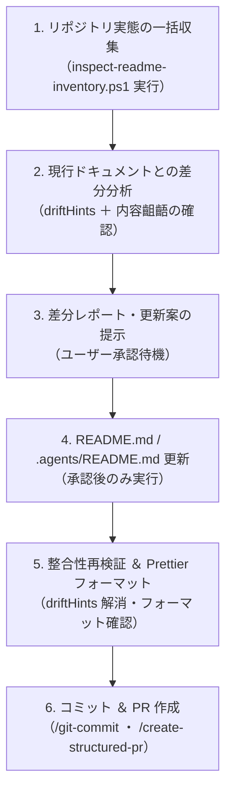

# Update README Workflow (`/update-readme`)

## 目的

モノレポ内のアプリケーション（`apps/*`）、共有パッケージ（`packages/*`）、開発スクリプト、および AI エージェント開発基盤（`.agents/*`）の増加・変更に追随し、**ルート `README.md`**（全体の地図）と **`.agents/README.md`**（開発者向けエージェント基盤ガイド）を常に最新・正確な状態へ維持するための定期更新ワークフローです。

調査スキル `readme-inventory` による機械的な実態収集と、ユーザー承認ゲートを組み合わせることで、記載漏れ・記述揺れ・意図しない上書きを防止します。

---

## CRITICAL CONSTRAINTS（厳格制約）

1. **調査スキル（`readme-inventory`）の必須実行**:
   - エージェントの記憶や推測だけでドキュメントを記述・更新してはならない。
   - 必ず最初にスキル `readme-inventory`（`inspect-readme-inventory.ps1`）を実行し、実測 JSON に基づいて差分判定および更新案を作成すること。

2. **ドキュメント更新前の絶対確認（承認ゲート）**:
   - いかなる理由があろうとも、差分レポートおよび更新案プレビューをユーザーへ提示し、明示的な承認（「OK」「進めてください」等）を得る前に `README.md` や `.agents/README.md` を書き換えてはならない。

3. **役割分離の原則**:
   - **ルート `README.md`（全体の地図）**: リポジトリの目的・設計思想、ワークスペース資産一覧、技術スタック、セットアップと主要コマンド、開発運用の入口、および `.agents/README.md` や個別ワークスペース README へのリンクに徹する。個別アプリの細かな操作手順や `.agents/` の詳細一覧は詰め込まないこと。
   - **`.agents/README.md`（開発者向けエージェント基盤ガイド）**: `.agents/rules/`、`.agents/workflows/`、`.agents/skills/` の構成・責務・一覧・標準利用フローに徹する。

4. **将来の個別 `README.md` 連携**:
   - `readme-inventory` の結果において `hasReadme: true` となっているワークスペース（`apps/*` / `packages/*`）が存在する場合、ルート `README.md` の資産一覧テーブルから該当の `readmePath` へ相対リンクを張ること。
   - 個別 `README.md` が未作成のワークスペースに対して、ユーザーの指示なく勝手に個別 `README.md` を新規生成してはならない。

5. **自律フェーズ移行の制限**:
   - 「差分・更新案提示 → ファイル更新」「更新・検証完了 → コミット」「コミット → PR 作成」の各境界はエージェントの判断で越えず、ユーザーの明示的な指示を待機すること。

---

## ワークフロー手順（標準 6 ステップサイクル）



---

### Step 1: リポジトリ実態の一括収集

1. 調査スキル `readme-inventory` のスクリプトを実行し、最新のリポジトリ構成とズレ検知ヒントを JSON で取得する：

```powershell
pwsh -File .agents/skills/readme-inventory/scripts/inspect-readme-inventory.ps1
```

2. 取得 JSON に `errorMessage` が含まれる場合は原因を報告して処理を中断する。
3. 現行の `README.md` および `.agents/README.md`（存在する場合）を読み込み、現在の記載内容を把握する。

---

### Step 2: 現行ドキュメントとの差分分析

取得 JSON と現行ドキュメントを照合し、以下の観点で差分を整理する：

1. **ルート `README.md` の差分**:
   - `driftHints.rootReadme.missingApps` / `missingPackages`: 新設されたワークスペースの記載漏れ
   - `driftHints.rootReadme.missingScripts`: ルート `package.json` に追加されたスクリプトの記載漏れ
   - `driftHints.rootReadme.unlinkedWorkspaceReadmes`: 追加された個別 `README.md` のリンク漏れ
   - `driftHints.rootReadme.missingAgentsReadmeLink`: `.agents/README.md` への導線漏れ
   - **削除・名称変更の検出**: 現行 `README.md` に残っているが実体（`apps`, `packages`, `scripts`, `ciWorkflows`）から消えた項目や、バージョン・依存関係・技術スタックの齟齬
2. **`.agents/README.md` の差分**:
   - `driftHints.agentsReadme.missingRules` / `missingWorkflows` / `missingSkills`: 新設されたルール・ワークフロー・スキルの記載漏れ
   - **削除・説明変更の検出**: 実体から削除された要素や、`SKILL.md` / ワークフロー frontmatter の `description` 変更に伴う説明のズレ

※ 差分が一切なく最新状態と完全一致している場合は、その旨を報告して更新不要として終了してよい。

---

### Step 3: 差分レポートと更新案プレビューの提示（Wait for User Input）

ユーザーへ以下の情報を整理して提示し、承認を待機する：

1. **差分サマリー**: 追加・変更・削除すべき項目の一覧（ルート `README.md` と `.agents/README.md` ごと）
2. **更新方針・構成プレビュー**: 変更後のセクション構成や主要な追記・修正内容
3. **承認確認**: 「この内容で `README.md` および `.agents/README.md` を更新してよろしいですか？」と明示的に確認し、**処理を一時停止する**。

---

### Step 4: ドキュメントの更新（Only After Explicit Approval）

ユーザーから明示的な承認を得た場合のみ、以下を更新する：

1. **ルート `README.md`**:
   - 推奨セクション構成：
     1. タイトル・概要（Overview）
     2. モノレポ構成・資産一覧（Workspaces: `apps/*`, `packages/*`）※`hasReadme: true` のものはリンク付与
     3. 技術スタック（Tech Stack）
     4. セットアップ・開発コマンド（Getting Started / Scripts）
     5. CI・品質検証（CI & Quality Gates）
     6. 開発規約・AI エージェント開発基盤（Development & `.agents/README.md` への導線）
2. **`.agents/README.md`**:
   - 推奨セクション構成：
     1. 概要・ディレクトリ構成（`rules/`, `workflows/`, `skills/` の役割分担）
     2. 開発ルール一覧（`.agents/rules/`）
     3. ワークフロー一覧（`.agents/workflows/` とスラッシュコマンド）
     4. スキル一覧（`.agents/skills/` と主要スクリプト）
     5. 標準的な開発サイクル（ルール・ワークフロー・スキルの連携フロー）

---

### Step 5: 整合性再検証・フォーマット適用

更新完了後、以下を実行して品質を担保する：

1. **差分ゼロの確認**:
   ```powershell
   pwsh -File .agents/skills/readme-inventory/scripts/inspect-readme-inventory.ps1
   ```
   - `driftHints.rootReadme` の各配列が空かつ `missingAgentsReadmeLink: false` であること。
   - `driftHints.agentsReadme` の `exists: true` かつ各配列が空であること。
2. **Prettier フォーマット適用・確認**:
   ```powershell
   npm run format -- README.md
   npm run format:check -- README.md
   ```
   - ※ `.agents/` は `.prettierignore` 対象のため、ルート `README.md` に対して Prettier チェックを実施する。`.agents/README.md` も Markdown 構文・リンク切れがないことを目視確認する。

---

### Step 6: コミット・Push・PR 作成（必要時）

変更をリポジトリへ反映する場合は、標準ワークフローに従ってユーザー承認を経ながら進行する：

1. 作業ブランチ（例: `docs/repo-<issue_id>-update-readme`）上で変更をステージングする。
2. `/git-commit` の手順に従い、コミットメッセージ案を提示 → 承認後にコミット＆ Push する。
3. `/create-structured-pr` の手順に従い、PR ドラフトを提示 → 承認後に PR を作成する。
